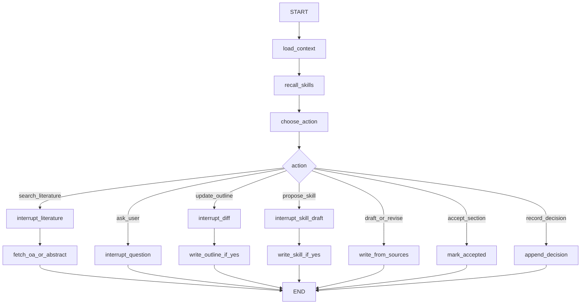

# 架构

DeepDocument 是一个本机进程：桌面窗口和 LangGraph 跑在一起。窗口负责展示和收集确认，图负责一轮只做一个动作。正文以项目目录里的文件为准，会话能否恢复以检查点为准。

## 进程

入口是 `app.py`。它打开桌面窗口，并用 `SqliteSaver` 编译图。`thread_id` 等于文稿项目的 slug。

- 没有待恢复的中断：把输入框中的话 `invoke` 进图。
- 图调用了 `interrupt(payload)`：左栏画出确认卡。此时可以关窗，检查点已经写下暂停位置和文件状态快照（修改时间戳或内容哈希）。
- 用户在确认卡上作出选择：恢复前检查文件是否被外部修改。若已改，提示用户选择保留哪一份，再以 `Command(resume=...)` 送回。`interrupt()` 的返回值就是这个选择。

不使用 `langgraph dev`，也不把服务暴露成网址。界面由 pywebview 画在系统 WebView2 里。

## 目标目录

下面是实现时的布局。初版文档不创建这些 Python 文件。

```
src/deepdocument/
  app.py
  graph/state.py
  graph/builder.py            # SqliteSaver，thread_id = 项目 slug
  graph/nodes.py
  literature/search.py        # OpenAlex，只返回索引中的真实记录
  literature/fetch.py         # 开放获取全文或摘要 → sources/<id>.md
  document/model.py
  document/store.py
  document/exporter.py        # 以 template.docx 为底稿写 export.docx
  ui/                        # 页面；marked 单文件放在 ui/vendor/
  memory/budget.py            # 按 docs/memory.md 的预算拼提示
  memory/profile.py           # 把反馈收成 user_profile.md
  skills/registry.py
  skills/proposer.py
  skills/builtin/             # outline、draft-section、revise-section
  llm/client.py               # 对话与 tool call 解析
  llm/tools.py                # ACTION_TOOLS 与白名单
projects/<slug>/
  brief.md outline.md sections/ meta.json decisions.jsonl
  literature.jsonl
  sources/<id>.md
  template.docx export.docx checkpoints.sqlite
skills_user/<name>/SKILL.md
user_profile.md
```

`projects/` 中的真实文稿默认不提交。`skills_user/` 和 `user_profile.md` 属于全局用户数据，跨项目共用。

## 图状态定义

```python
class GraphState(TypedDict):
    project_slug: str
    cursor: str  # 当前节 id
    pending_confirmation: dict | None  # 确认卡 payload
    last_observation: str
    file_snapshots: dict[str, str]  # 文件路径 → 修改时间戳或哈希，用于检测外部修改
```

## 模块职责

| 模块 | 职责 |
| --- | --- |
| `app.py` | 打开窗口，把用户输入或确认结果送进图 |
| `graph/builder.py` | 编译带检查点的图 |
| `graph/nodes.py` | 读盘、召回 skill、选出一个动作、落盘 |
| `literature/search.py` | 用题目请求 OpenAlex，约 8 条 |
| `literature/fetch.py` | 对已勾选条目取开放获取全文或摘要 |
| `document/store.py` | 读写文稿目录 |
| `document/exporter.py` | 合成 `export.docx`，不修改 `template.docx` |
| `skills/registry.py` | 扫描内置 skill 和 `skills_user/` |
| `skills/proposer.py` | 起草 skill 文本，不直接写文件 |
| `memory/budget.py` | 按预算从磁盘拼出本轮提示 |
| `memory/profile.py` | 把已发生的反馈收成 `user_profile.md` |
| `llm/client.py` | OpenAI 兼容对话接口；解析 tool call |
| `llm/tools.py` | 模型可选动作的 function schema 与白名单 |

## 图



必须暂停的有三处：覆盖大纲、把检索结果收进文献、把 skill 写入 `skills_user/`。节的草稿和按反馈作出的修订直接落盘。

`load_context` 每轮从磁盘重读文稿、已确认文献、反馈和用户画像。检查点不保存各节正文，只保留恢复确认卡所需的状态。

## 从一句话到文稿

1. 用 `brief.md` 的题目向 OpenAlex 检索约 8 条真实记录。
2. 用户勾选要使用的条目。未勾选记为 `rejected`。
3. 对 `accepted` 条目抓取开放获取全文或摘要，写入 `sources/<id>.md`。
4. 若存在 `template.docx`，从其标题样式提出大纲，确认后写入。`summary` 可以只有「总结」一节。
5. 按 `kind` 起草。每一段都要能对上某条摘录。
6. 用户指出某一节的问题，则只修订那一节，更新 Word，并把意见收成画像。同类意见再次出现时提议 skill。

没有题目或种类时，先 `ask_user`，不先写正文。`template.docx` 可选；没有它时导出使用空白文档。

## 依赖

库的选择和理由见 [stack.md](stack.md)。实现阶段再安装，这一版文档不安装。模型密钥只放 `.env`。

## 文件与检查点

- 文稿文件是正文真相。图每次从磁盘读，写回也落盘。
- `checkpoints.sqlite` 是会话真相。里面有对话位置和尚未完成的 `interrupt`。关窗再开靠它。
- `export.docx` 是交稿副本，由 Markdown 套进模板合成，不反过来当编辑源。
